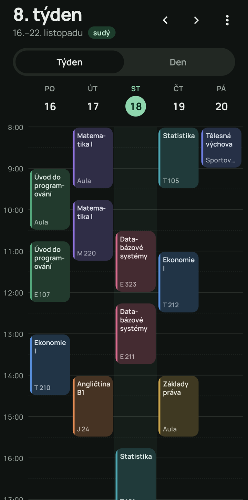
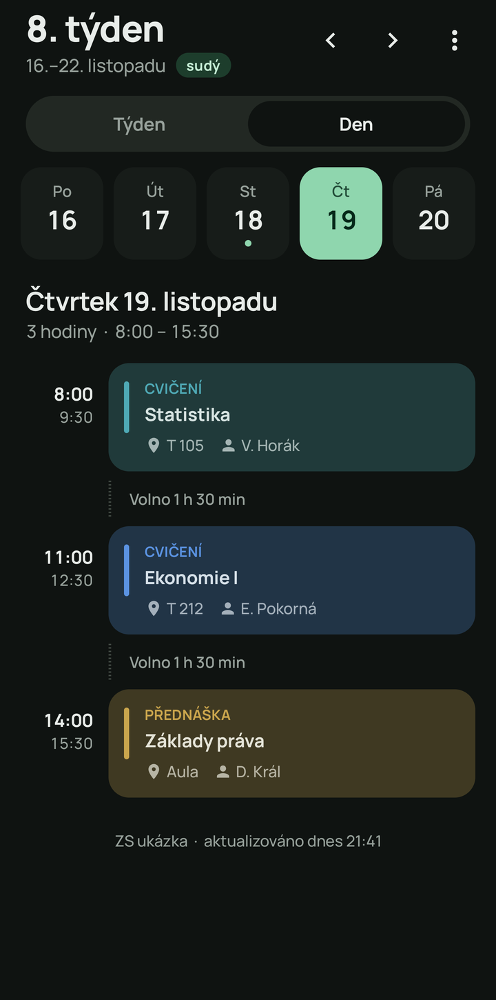
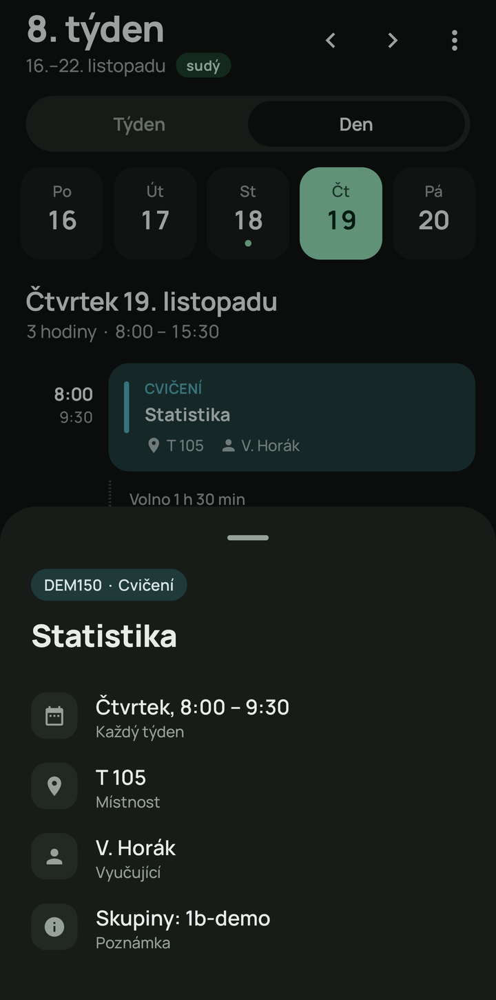
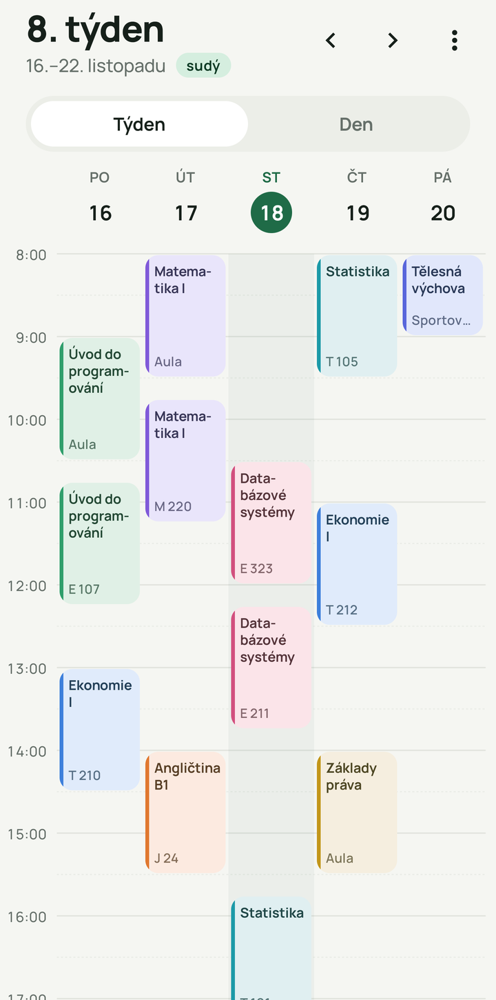

<div align="center">


# Rozvrh ČZU

**Tvůj rozvrh z UIS ČZU v mobilu, bez věčného přihlašování.**
Týdenní přehled jako v Bakalářích, sudé a liché týdny, widgety na plochu a funguje i offline.

[](https://github.com/Mirda-Nig/CZU-rozvrh/releases/latest/download/Rozvrh-CZU.apk)

[Webová stránka](https://mirda-nig.github.io/CZU-rozvrh/) · [Všechny verze](https://github.com/Mirda-Nig/CZU-rozvrh/releases) · [Nahlásit chybu](https://github.com/Mirda-Nig/CZU-rozvrh/issues)






<sub>Na screenshotech je smyšlený ukázkový rozvrh.</sub>

</div>

---

## Co umí

- **Přihlásíš se jednou.** Když UIS přihlášení vyprší, aplikace se sama přihlásí znovu. Funguje i dvoufázové ověření.
- **Týden jako kalendář.** Všechny dny vedle sebe, každý předmět má svou barvu a červená čára ukazuje aktuální čas.
- **Denní přehled.** Ukáže, co právě probíhá a kolik času zbývá, co bude další a kolik máš mezi hodinami volna.
- **Odpočet v notifikacích.** Během hodiny ukazuje nahoře v liště, kolik zbývá do konce, stejně jako stopky. O přestávce odpočítává do začátku další hodiny. Dá se vypnout v Nastavení.
- **Sudé a liché týdny.** Vidíš jen hodiny, které v daném týdnu opravdu máš. Bere se to z poznámek v UIS („Sudý týden“).
- **Widgety na plochu.**
  - *Rozvrh na den*: zbývající hodiny dnes, nebo nejbližší den s výukou.
  - *Další hodina*: „TEĎ · ještě 25 min“, „ZA 15 MIN · 10:30“…
- **Offline.** Poslední stažený rozvrh je uložený v telefonu.
- **Skrytí dnů bez výuky**, tmavý i světlý režim a období výuky podle UIS (mimo semestr ukáže prázdný týden).

## Instalace

1. Stáhni **[Rozvrh-CZU.apk](https://github.com/Mirda-Nig/CZU-rozvrh/releases/latest/download/Rozvrh-CZU.apk)** v telefonu.
2. Otevři stažený soubor. Android se zeptá, jestli povolit instalaci z prohlížeče, tak dej **Povolit**.
3. Kdyby se ozval **Google Play Protect** („Neznámá aplikace“), klepni na **Další podrobnosti → Přesto nainstalovat**. Aplikace není z Obchodu Play, proto to hlásí.
4. Přihlas se svým jménem a heslem do UIS. Číslo rozvrhu se najde samo.

Novou verzi stačí stáhnout a nainstalovat přes starou, přihlášení zůstane. Potřebuješ Android 8.0 nebo novější.

## Soukromí

- Heslo se ukládá **jen v tvém telefonu**, zašifrované klíčem z Android Keystore.
- Aplikace komunikuje **jen s `is.czu.cz`**, stejně jako tvůj prohlížeč. Žádný vlastní server, žádná analytika ani reklamy.
- Zdrojový kód je celý tady, můžeš si ho projít.

## Pro vývojáře

<details>
<summary>Sestavení ze zdrojáků</summary>

Otevři složku projektu v Android Studiu. Kdyby chtělo Android SDK 36.1, nech ho doinstalovat.

```bash
./gradlew installDebug              # nainstaluje debug verzi do připojeného mobilu
./gradlew testDebugUnitTest         # testy parseru a logiky widgetů
./gradlew installDebug -Pdemo=true  # ukázková verze s vymyšleným rozvrhem (na screenshoty)
./gradlew assembleRelease           # podepsané APK → app/build/outputs/apk/release/
```

**Podepisování release.** Klíč se čte ze souboru `keystore.properties` v kořeni projektu (je v `.gitignore`):

```properties
storeFile=keystore/czurozvrh-release.jks
storePassword=…
keyAlias=czurozvrh
keyPassword=…
```

Bez tohoto souboru se release podepíše debug klíčem. Takové APK nepůjde nainstalovat jako aktualizace přes oficiální verzi.

| Složka | Obsah |
|---|---|
| `app/src/main/java/.../data/` | přihlášení do UIS, stažení a parsování rozvrhu (formát „Seznam“), šifrované údaje, cache |
| `app/src/main/java/.../ui/` | Jetpack Compose obrazovky a téma |
| `app/src/main/java/.../widget/` | Glance widgety a jejich plánované obnovování (WorkManager) |
| `docs/` | webová stránka projektu (GitHub Pages) |

</details>

---

<sub>Neoficiální studentský projekt, není nijak spojený s Českou zemědělskou univerzitou v Praze. Logo ČZU patří ČZU.</sub>
